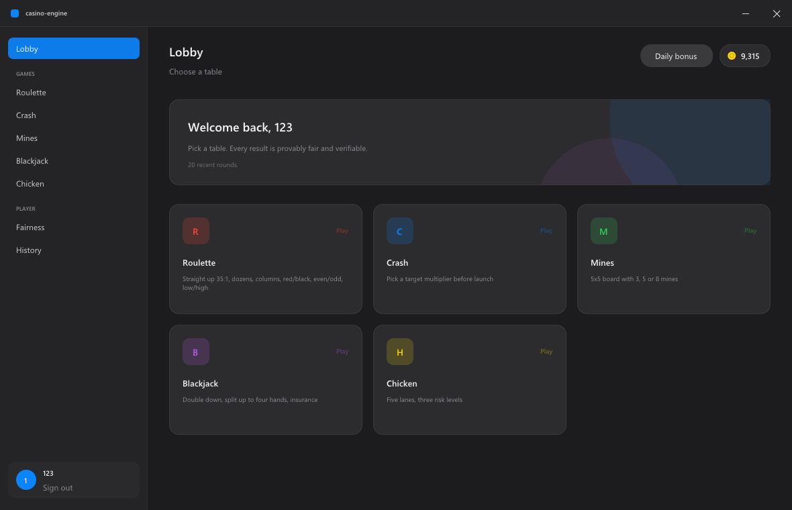
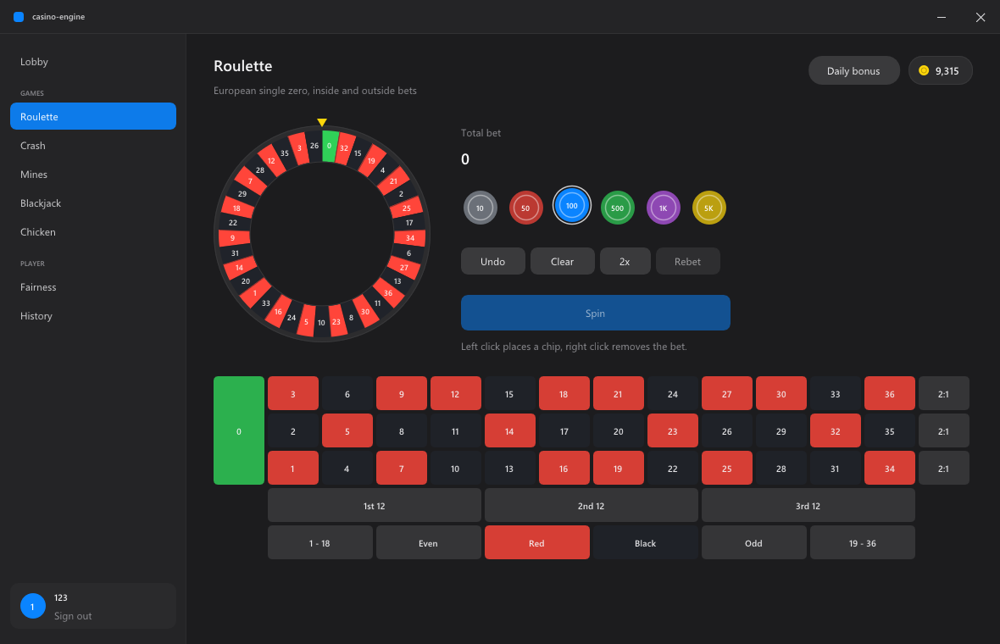

# casino-engine

<p align="center">
  
</p>

<p align="center">
  
  
  
  
  
  <a href="LICENSE"></a>
</p>

A provably fair casino with an authoritative Node.js server and a native Windows desktop client rendered with Dear ImGui and DirectX 11. Dark UI, animated games and sidebar tabs.

> **Virtual coins only.** No real money, payments or withdrawals. Educational project.

<p align="center">
  
</p>

## Screenshots

<p align="center">
  
</p>

## Games

| Game | Rules |
| --- | --- |
| Roulette | European single zero, up to 40 bets per spin: straight 35:1, dozens and columns 2:1, red/black, even/odd, 1-18/19-36 1:1 |
| Crash | Live multiplier, cash out whenever you want before it crashes, 1% house factor |
| Mines | 5x5 board, 3 / 5 / 8 mines, cash out anytime |
| Blackjack | Single deck, dealer stands on 17, blackjack pays 3:2, double down, split up to 4 hands, insurance 2:1 |
| Chicken | Up to 5 lanes, safe / spicy / wild risk |

## Provably fair

Each result is derived from `HMAC-SHA256(server_seed, client_seed:nonce:game:cursor)` with rejection sampling. The server publishes `sha256(server_seed)` before the round and reveals the seed after it settles. The client's **Fairness** tab checks the commitment and recomputes roulette results locally.

## Server

```bash
cd server
npm ci
npm test
npm start
```

Listens on `127.0.0.1:8420` by default. See `server/.env.example` for `CASINO_HOST`, `CASINO_PORT`, `CASINO_DATABASE_PATH`, `CASINO_STARTING_BALANCE` and `CASINO_DAILY_BONUS`.

## Client

Requirements: Visual Studio 2022 and [vcpkg](https://github.com/microsoft/vcpkg).

```bash
cd client
cmake -B build -S . -A x64 -DCMAKE_TOOLCHAIN_FILE="$VCPKG_ROOT/scripts/buildsystems/vcpkg.cmake"
cmake --build build --config Release
```

Run `build/Release/casino-engine.exe` with the server running, then create an account.

## API

| Method | Path |
| --- | --- |
| `POST` | `/v1/auth/register`, `/v1/auth/login`, `/v1/auth/logout` |
| `GET` | `/v1/auth/me`, `/v1/casino/state`, `/health` |
| `POST` | `/v1/casino/daily`, `/roulette` |
| `POST` | `/v1/casino/crash/{start,status,cashout}` |
| `POST` | `/v1/casino/mines/{start,reveal,cashout}` |
| `POST` | `/v1/casino/chicken/{start,jump,cashout}` |
| `POST` | `/v1/casino/blackjack/{start,action}` |

Casino routes require `Authorization: Bearer <token>`. Every action carries a `request_id` for idempotent retries.

## Project layout

```text
server/   Express API, games, fairness, JSON datastore, tests
client/   C++20 Dear ImGui + DX11 desktop client
```

## Security

See [SECURITY.md](SECURITY.md).

## License

Released under the [MIT License](LICENSE).
